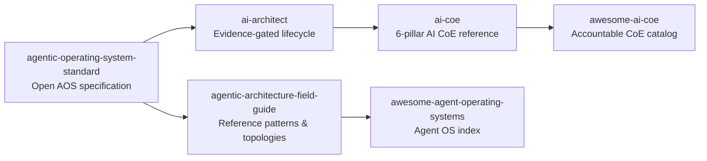

# AI Architect Studio

Evidence-gated enterprise AI architecture, Center of Excellence playbooks, and agent operating standards.

**Website:** [frankx.ai/ai-architect](https://frankx.ai/ai-architect) · **Ecosystem:** [Starlight Intelligence](https://github.com/Starlight-Intelligence) · [Starlight Systems](https://github.com/Starlight-Intelligence-Systems) · [Arcanea Labs](https://github.com/Arcanea-Labs) · [GenCreator](https://github.com/GenCreator-ai) · [FrankX](https://github.com/FrankX-AI)

---

## Overview

AI Architect Studio publishes vendor-neutral standards, reference architectures, and Center of Excellence (CoE) playbooks for engineering teams operating production AI and multi-agent systems.

## System topology



## Flagship repositories

| Repository | Purpose | Link |
| :--- | :--- | :--- |
| [**ai-architect**](https://github.com/AI-Architect-Studio/ai-architect) | Evidence-gated architecture lifecycle, decision records, and system design templates. | [Website](https://frankx.ai/ai-architect) |
| [**ai-coe**](https://github.com/AI-Architect-Studio/ai-coe) | Reference AI Center of Excellence across Strategy, Governance, Talent, Technology, Data, and Ethics. | [Website](https://frankx.ai/ai-architect) |
| [**agentic-architecture-field-guide**](https://github.com/AI-Architect-Studio/agentic-architecture-field-guide) | Vendor-neutral field guide for multi-agent topologies, memory routing, and evaluation gates. | [Website](https://frankx.ai/ai-architect) |
| [**agentic-operating-system-standard**](https://github.com/AI-Architect-Studio/agentic-operating-system-standard) | Open specification for agentic operating systems: lane locks, Maker-Checker gates, and state handovers. | [Website](https://frankx.ai/ai-architect) |
| [**awesome-ai-coe**](https://github.com/AI-Architect-Studio/awesome-ai-coe) | Curated catalog of frameworks, governance models, and benchmarks for enterprise AI Centers of Excellence. | [Website](https://frankx.ai/ai-architect) |
| [**awesome-agent-operating-systems**](https://github.com/AI-Architect-Studio/awesome-agent-operating-systems) | Structured index of agent operating systems, coding harnesses, and orchestration runtimes. | [Website](https://frankx.ai/ai-architect) |

## Quickstart

```bash
# Clone the AI Center of Excellence reference kit
git clone https://github.com/AI-Architect-Studio/ai-coe.git

# Explore the Agentic Architecture Field Guide
git clone https://github.com/AI-Architect-Studio/agentic-architecture-field-guide.git
```

## Engineering standards

Every repository in **AI Architect Studio** follows the Starlight estate engineering contract:

1. **Draft-first pull requests**: Open pull requests in draft mode (`gh pr create --draft`). CI workflows run only when a pull request is marked ready for review or lands on `main`.
2. **Independent verification**: Maker harness and Checker harness must differ (`Maker-Harness` != `Checker-Harness`).
3. **Zero committed secrets**: Credentials live in local environment files or Infisical. Pre-commit and CI gates reject secret patterns.
4. **Editorial clarity**: Public documentation uses sentence case headings, concrete verbs, and verified metrics.

---

<sub>Maintained by <a href="https://github.com/frankxai">Frank Riemer (frankxai)</a> · Built on the <a href="https://github.com/Starlight-Intelligence-Systems/Starlight-Intelligence-System">Starlight Intelligence Protocol (SIP)</a></sub>
